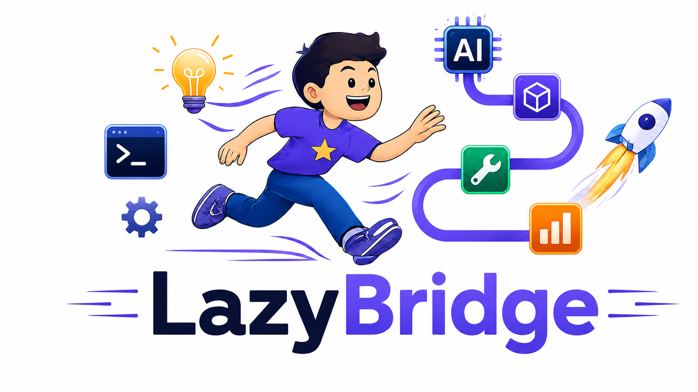

---
hide:
  - navigation
  - toc
title: LazyBridge — Claude Code and Codex as agent engines
description: Interchangeable engines, opposite-engine review, async delegation, shared projects and quota routing through LazyTools.
---

<section class="lb-hero">
  <div class="lb-hero__copy">
    <div class="lb-pill">Engine + Tools + State &bull; Python-first</div>
    <h1>Claude Code and Codex, <span class="accent">as engines of your agent</span>.</h1>
    <p class="lb-subhead">Run a LazyBridge Agent on your subscription-backed coding runtime or a provider API. Keep your tools and state. Let one engine write and the other review, with LazyTools connecting the work.</p>
    <div class="lb-cta-row">
      <a href="#engines" class="lb-btn lb-btn--primary">Start with the engines &rarr;</a>
      <a href="built-with/" class="lb-btn lb-btn--ghost">Built with LazyBridge</a>
    </div>
    <div class="lb-chips"><span class="lb-chip">Interchangeable engines</span><span class="lb-chip">Opposite-engine review</span><span class="lb-chip">Durable projects</span></div>
  </div>
  <div class="lb-hero__art"></div>
</section>

<section class="lb-feature-cards">
  <div class="lb-card"><div class="lb-card__body"><h3>Swap the engine</h3><p>ClaudeCodeEngine, CodexEngine and LLMEngine use the same Agent surface for tools, memory and sessions.</p><a href="#engines" class="lb-card__link">See the code &rarr;</a></div></div>
  <div class="lb-card"><div class="lb-card__body"><h3>Separate writing from review</h3><p>Delegate a job, keep its evidence, and route its review to the opposite engine. The producer never signs its own review.</p><a href="#collaboration" class="lb-card__link">Follow a job &rarr;</a></div></div>
  <div class="lb-card"><div class="lb-card__body"><h3>Keep work in a shared project</h3><p>Plans, task claims, acceptance contracts and verification records live in a Store. Schedules render as deterministic Gantt charts.</p><a href="#projects" class="lb-card__link">See the project layer &rarr;</a></div></div>
</section>

<div class="lb-home-section" markdown="1">

## Claude Code / Codex as engines {#engines}

**Agent = Engine + Tools + State.** `ClaudeCodeEngine` runs through the Claude Agent SDK and its local runtime; `CodexEngine` speaks to `codex app-server`. With a subscription login, calls use that plan's quota instead of per-token API billing. The login determines the billing path; LazyBridge does not change an API-key login into a subscription login.

```python
from lazybridge import Agent, ClaudeCodeEngine, CodexEngine, LLMEngine, Memory, Session

def project_status() -> str:
    """Return this example project's status."""
    return "The draft is ready for review."

state = dict(tools=[project_status], memory=Memory(), session=Session())
agent = Agent(engine=ClaudeCodeEngine(), **state)
agent = Agent(engine=CodexEngine(), **state)  # same tools, memory and session
agent = Agent(engine=LLMEngine("gpt-6.1-sol"), **state)  # API-backed alternative
```

This constructs the alternatives without making a model call. Subscription engines need their local runtime signed in; the API alternative needs provider credentials. The shared surface does not imply identical native permissions or model capabilities.

For continuity across processes, use `persist_session=True` / `session_id` on Claude or `persist_thread=True` / `thread_id` on Codex. Both accept `session_alias` through `SessionRegistry`. LazyBridge state can be reused when swapping engines; a native session or thread stays with its original engine.

[Claude Code engine](https://core.lazybridge.com/guides/full/claude-code-engine/) · [Codex engine](https://core.lazybridge.com/guides/full/codex-engine/) · [Engine permissions](https://core.lazybridge.com/guides/full/coding-agent-config/)

</div>

<div class="lb-home-section" markdown="1">

## One writes, the other reviews {#collaboration}

**The producer never signs its own review.** Configure a different engine as the reviewer for a small output, or use the LazyTools code bridge for repository work that needs time, write access and approvals.

```python
from lazybridge import Agent, ClaudeCodeEngine, CodexEngine

reviewer = Agent(name="codex-reviewer", engine=CodexEngine())
writer = Agent(name="claude-writer", engine=ClaudeCodeEngine(),
               verify=reviewer, max_verify=3)
result = writer("Draft a Python function that blocks deployment from Friday 15:00 through Sunday.")
print(result.text())
```

`verify=` checks the output and retries with feedback. It returns the last output if the attempt limit is exhausted, so a returned result is not proof of approval. Use explicit verification records and deterministic checks when acceptance must gate the next step.

For longer tasks, the **async code bridge** gives you `run`, `pending`, `approve`, `result` and `cancel`. Detached jobs run in a separate process; a durable ticket queue holds escalation requests with the command and reason. Unfinished jobs retain best-effort workspace evidence to inspect after a failure.

```sh
lazytools-code-bridge run --detach --engine claude --cwd . --task "Implement the agreed retry fix" --session retry-fix
lazytools-code-bridge pending --json
lazytools-code-bridge approve APPROVAL_ID
lazytools-code-bridge result WRITER_JOB_ID
lazytools-code-bridge run --detach --tier writing --review-of WRITER_JOB_ID --cwd . --task "Review the retry fix; report defects without editing"
lazytools-code-bridge cancel ACTIVE_JOB_ID --reason "Stop this attempt"
```

Run each command at the relevant stage: replace the uppercase IDs with IDs printed by the bridge, inspect a ticket before approving, and launch review after the writer finishes. `--tier … --review-of` excludes the producer's engine; if the opposite engine cannot be admitted, review is refused. `wait JOB_ID` follows a detached job without owning its lifetime. `--timeout` configures the engine request timeout.

The synchronous MCP tools include `codex_code_review`, `codex_write`, `claude_code_review`, `claude_ask` and `claude_code_write`. Their `session_name` aliases resume durable conversations; MCP calls still wait for completion.

[Async bridge and approvals](https://tools.lazybridge.com/code-bridge/) · [Code support tools](https://tools.lazybridge.com/code-support/) · [Worked writer/reviewer example](blog/posts/claude-writes-codex-reviews.md)

</div>

<div class="lb-home-section" markdown="1">

## A shared project layer {#projects}

LazyTools keeps project records, plans and schedules in a LazyBridge `Store`, with `DurableBlackboard` task claims, acceptance contracts, verification states and a per-project quota brake. Gantt charts render from those records in code, without a model call. Point both callers at the same Store to share state.

```python
from lazybridge import Store
from lazybridge.ext.planners import DurableBlackboard
from lazytools.projects import brake, owner, records

store = Store()  # in-memory demo; use Store(db="projects.sqlite") for persistence
records.open_project(store, project_id="retry-fix", title="Retry fix",
                     objective="Handle transient failures and verify boundary cases")
owner.set_project_owner(store, "retry-fix", "shared")
board = DurableBlackboard(store, plan_id="project:retry-fix")
board.set_plan("Write, then review with the opposite engine",
               ["Implement retry fix", "Review and run boundary checks"])
print(brake.get_project_brake_enabled(store, "retry-fix"))  # True
```

This creates a draft and its task board. Promotion, scheduling, claiming and contract acceptance are separate operations. Owner labels are not access controls. The brake gates work through admission APIs; it does not stop a session's direct work or kill a running process.

[Project layer, contracts and Gantt](https://tools.lazybridge.com/projects/)

</div>

<div class="lb-home-section" markdown="1">

## Choose an engine and model from remaining quota {#quota-routing}

The deterministic router walks the `basic`, `writing`, `thinking` and `critical` tier ladders and ranks eligible choices by quota admission margins. It accounts for engine/model restrictions, native session continuity and review separation. The bridge checks the selected model's weekly bucket and the engine's short window before launch.

```sh
lazytools-code-bridge route --tier writing --cwd . --json
```

This reads quota and explains the engine, model, effort and exclusions without launching a coding job. `run --tier writing` uses the same routing logic to launch work. Shared `route()` / `recommend()` default to autonomous admission; the bridge uses operator-directed admission, while still refusing absolute ceilings and unreadable telemetry.

The ladders are configurable policy, not measured model rankings. There is no measured per-model subscription quota cost or published routing performance comparison here. **Planned proof:** a reproducible demo and benchmark comparing a fixed-engine baseline with quota routing on completion rate, accepted reviews, elapsed time and quota consumed.

[Routing behavior and constraints](https://tools.lazybridge.com/code-bridge/#choose-a-model-from-quota)

</div>

<div class="lb-home-section" markdown="1">

## LazyTools connects the work {#lazytools}

LazyBridge supplies the Agent and engine primitives. **LazyTools is the integration layer**: MCP server, async code bridge, shared projects, routing and connectors. Expose a focused tool set to your coding runtime rather than maintaining a separate integration for every agent.

```sh
lazytools-mcp projects code_review claude_review code_write code_sessions --allow-unsafe
```

This serves the named providers over stdio. Coding providers require explicit opt-in even for reviews because repository text and diffs leave the machine for model processing. `code_write` also requires `LAZYTOOLS_CODE_WRITE_BASE_DIR`; configure `LAZYTOOLS_PROJECTS_STORE_DB` for a durable shared project Store. `--allow-unsafe` enables mutating tools, so choose providers deliberately. The async bridge keeps its separate ticket workflow.

The source versions checked here are **LazyBridge 1.8.0** and **LazyTools 0.10.1** (distribution `lazytoolkit`, import `lazytools`). LazyTools currently declares Alpha maturity; shipped modules are not a blanket stability promise.

Install into your project environment:

```sh
python -m pip install "lazybridge[claude-code,openai]==1.8.0"
python -m pip install "lazytoolkit[engines,mcp] @ git+https://github.com/selvaz/LazyTools.git@v0.10.1"
```

Sign the local Claude Code and Codex runtimes into their subscription accounts before using them as engines. Installing Python packages does not perform that sign-in. Connectors and data tools are available when your project needs them.

[MCP server setup](https://tools.lazybridge.com/mcp-server/) · [LazyTools docs](https://tools.lazybridge.com/) · [LazyBridge quickstart](https://core.lazybridge.com/quickstart/)

</div>

<div class="lb-home-section" markdown="1">

## Built with LazyBridge {#built-with}

### LazyCommittee — private repository

An AI investment committee organised as a linear pipeline of dated documents: daily digests for geopolitics, economics, markets and central banks → weekly world state (strategic and tactical) → asset-class views → portfolio. It uses LazyBridge with Claude Code and Codex as engines. Code computes the numbers; the LLM receives the results. Deterministic publication checks cover freshness, numeric lint and source mapping; blocking findings gate publication, while some narrative lint findings remain warnings. Daily and weekly runs are scheduled.

These projects are private. If you are interested in collaborating, write to [lazybridgelabs@gmail.com](mailto:lazybridgelabs@gmail.com).

### LazyBricks — private repository

A local 3D brick-model editor with a Three.js front end, FastAPI + SQLite back end and an index of the full installed LDraw Official Parts Library. A phone interface and MCP server let a person and an AI agent work on the same projects and revisions. Mobile interaction has been checked through touch/viewport emulation; a physical-phone test remains open.

These projects are private. If you are interested in collaborating, write to [lazybridgelabs@gmail.com](mailto:lazybridgelabs@gmail.com).

[Read the project notes](built-with.md)

</div>

<section class="lb-home-cta">
  <h2>Build a workflow with two engines and one project.</h2>
  <div class="lb-cta-row">
    <a href="https://core.lazybridge.com/guides/full/coding-agents/" class="lb-btn lb-btn--primary">Coding agents in practice &rarr;</a>
    <a href="mailto:lazybridgelabs@gmail.com" class="lb-btn lb-btn--ghost">lazybridgelabs@gmail.com</a>
  </div>
</section>
