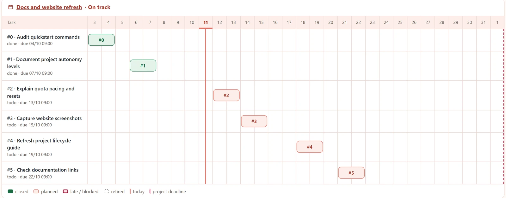
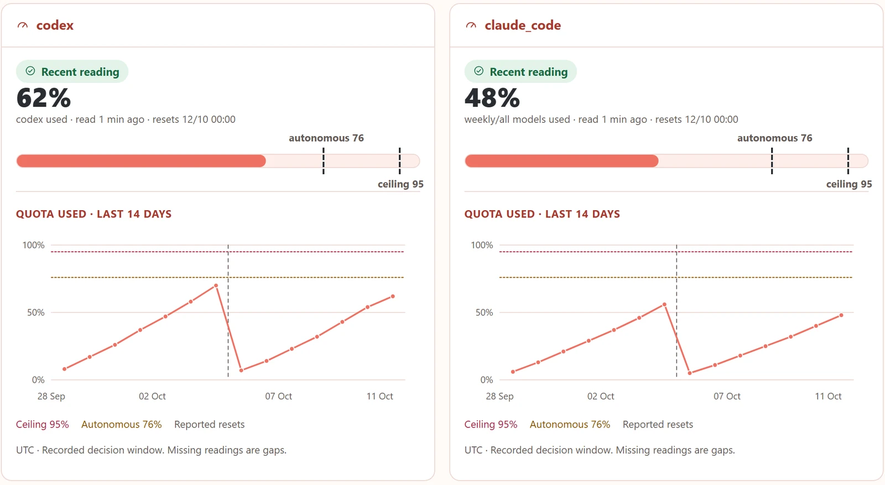
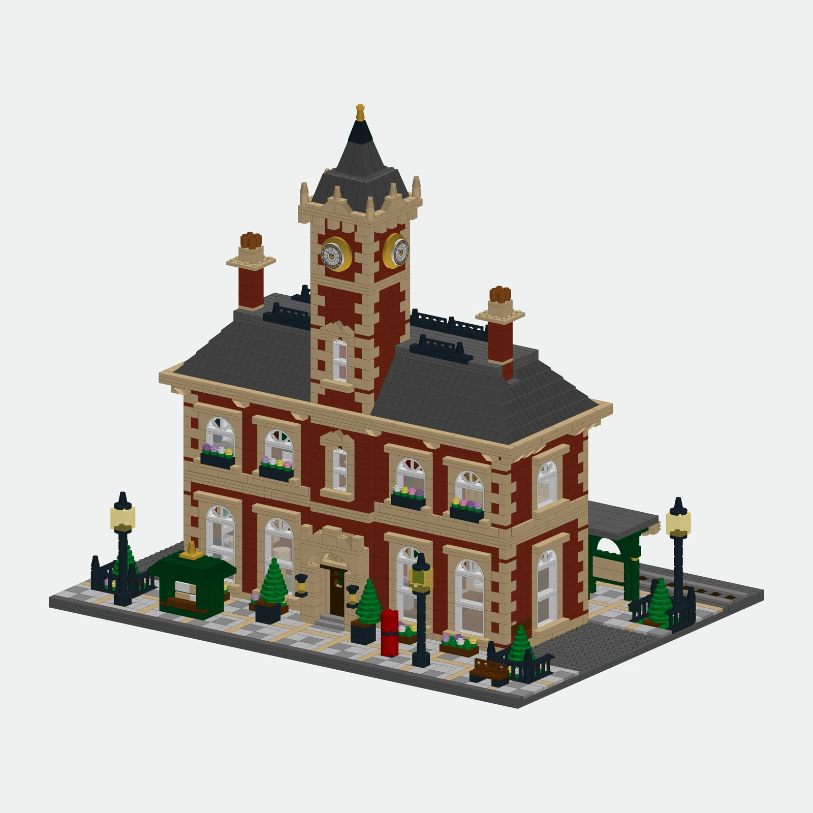
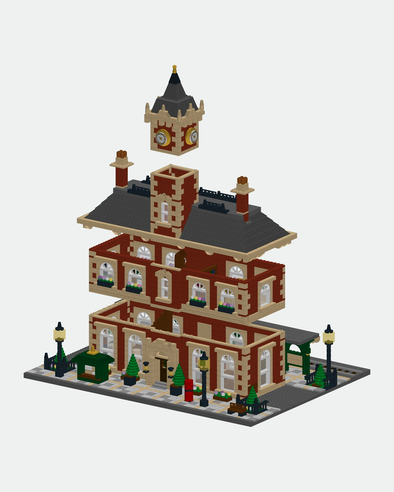
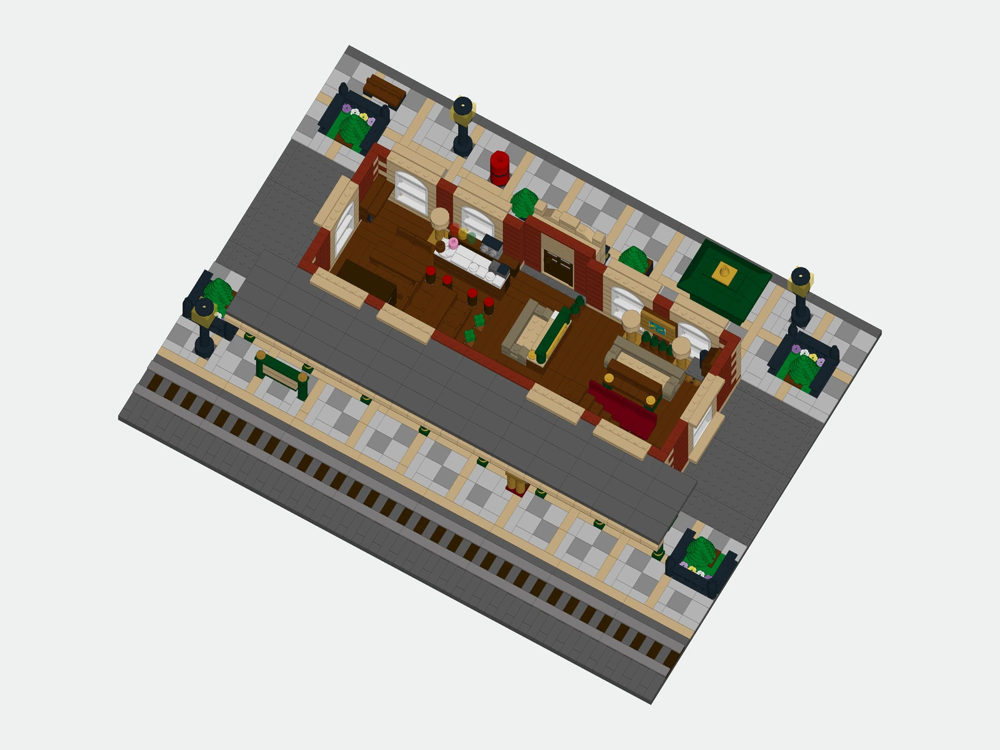
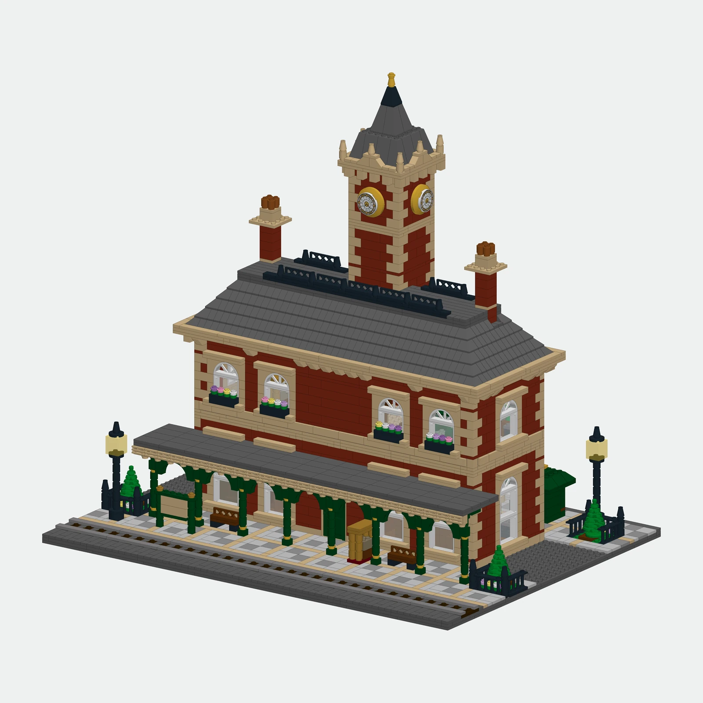
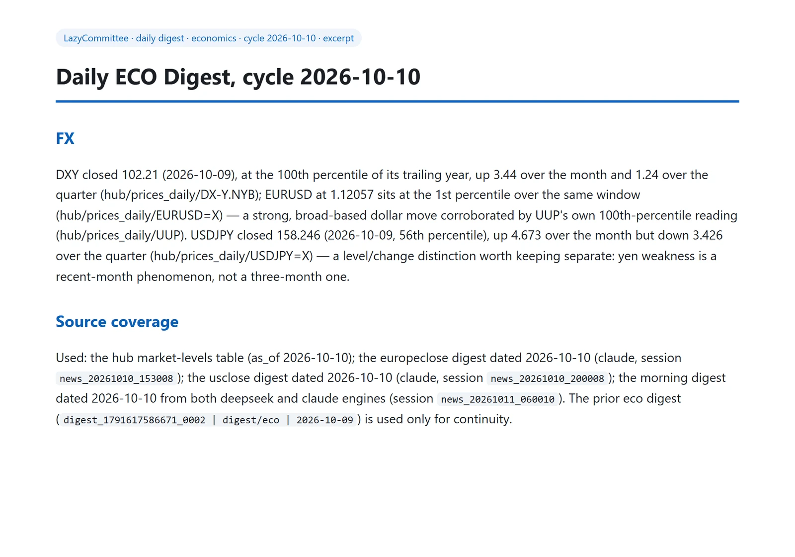
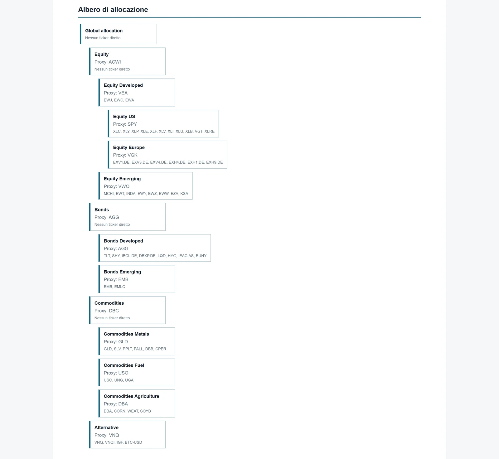

---
hide:
  - navigation
  - toc
title: "LazyBridge — one agent, any engine: subscription or API"
description: "Claude Code and Codex on your subscription, or any API model per token — same Agent, same tools, same state. Build complex pipelines and see real work built with LazyBridge."
---

<section class="lb-hero lb-manifesto">
  <div class="lb-hero__copy">
    <div class="lb-pill">Agent = Engine + Tools + State</div>
    <h1>One agent. Any engine. <span class="accent">Subscription or API.</span></h1>
    <p class="lb-subhead">LazyBridge treats Claude Code and Codex on your subscription exactly like API models billed per token: same Agent, same tools, same state. Swap the engine in one line, and build pipelines where LLMs from different providers work together and review each other’s work — catching hallucinations and mistakes a single model would miss, and producing better code.</p>
    <ul class="lb-principles">
      <li>Subscription agents and API models are equal engines.</li>
      <li>Models from different providers review each other. The producer never signs its own review.</li>
      <li>Code computes. The LLM reads the results.</li>
      <li>Use deterministic gates before anything ships.</li>
    </ul>
    <div class="lb-cta-row">
      <a href="#built-with" class="lb-btn lb-btn--primary">See what it builds &rarr;</a>
      <a href="#engines" class="lb-btn lb-btn--ghost">Read the code &rarr;</a>
    </div>
  </div>
  <div class="lb-hero__art"></div>
</section>

<div class="lb-demo lb-home-section lb-why" markdown="1">

## Different models. One working system. {#why}

<div class="lb-demo__grid" markdown="1">
<div markdown="1">

**LazyBridge began as a bridge between LLMs from different providers.** A model rarely spots its own mistakes; a model trained differently often does. So in LazyBridge they work together and review each other’s work, catching hallucinations and errors before they reach the result.

**One building block: Agent = Engine + Tools + State.** Everything is a tool: a function, another agent, a whole pipeline. The engine can be anything: an API model, Claude Code or Codex on your subscription, a human, or a deterministic **Plan**. Every level keeps the same contract (tools, memory, verification, one Envelope out), so pipelines nest inside pipelines.

**Build a team once. Reuse it as one tool in the next thing you build.**

[Why LazyBridge →](https://core.lazybridge.com/why/)

</div>
<div class="lb-demo__code" markdown="1">

```python
from lazybridge import (Agent, ClaudeCodeEngine, CodexEngine,
                        LLMEngine, Plan, Step)

# OpenAI researches (API); Claude Code writes (subscription);
# Codex, another provider, reviews the draft before it moves on.
research = Agent(name="research", engine=LLMEngine("gpt-6.1-sol"))
write = Agent(name="write", engine=ClaudeCodeEngine(),
              verify=Agent(name="review", engine=CodexEngine()))

# A deterministic Plan is just another engine; agents are its tools.
report = Agent(name="report", engine=Plan(Step("research"), Step("write")),
               tools=[research, write])

# The whole pipeline is now one tool for the next agent.
desk = Agent(engine=LLMEngine("claude-opus-5-5"), tools=[report])
```

<div class="lb-nest" aria-label="Diagram: an Agent whose tools include a Plan-driven Agent, whose tools are agents from different providers with a cross-provider reviewer">
<div class="lb-nest__box"><span class="lb-nest__tag">Agent · desk</span><span class="lb-nest__engine">engine: Claude Opus (API)</span>
<div class="lb-nest__box"><span class="lb-nest__tag">Agent · report</span><span class="lb-nest__engine">engine: Plan (deterministic)</span>
<div class="lb-nest__row">
<div class="lb-nest__leaf">research<br><small>OpenAI · API</small></div>
<div class="lb-nest__leaf">write<br><small>Claude Code · subscription</small><br><small class="lb-nest__review">⟲ reviewed by Codex</small></div>
</div>
</div>
</div>
</div>

</div>
</div>

</div>

<div class="lb-demo lb-home-section" markdown="1">

## Subscription or tokens: same Agent. {#engines}

<div class="lb-feature-cards lb-engine-parity">
  <div class="lb-card"><div class="lb-card__body"><h3>Claude Code</h3><p><strong>Subscription</strong> · your Claude plan quota.</p><p><code>ClaudeCodeEngine()</code></p></div></div>
  <div class="lb-card"><div class="lb-card__body"><h3>Codex</h3><p><strong>Subscription</strong> · your ChatGPT plan quota.</p><p><code>CodexEngine()</code></p></div></div>
  <div class="lb-card"><div class="lb-card__body"><h3>API models</h3><p><strong>Per token</strong> · Anthropic, OpenAI, Google, DeepSeek, LiteLLM.</p><p><code>LLMEngine("model-id")</code></p></div></div>
</div>

<div class="lb-demo__grid" markdown="1">
<div markdown="1">

**One Agent contract for every engine.** Tools, memory, session and verification are LazyBridge objects, not engine features: change the engine and the rest of your pipeline stays the same. Mix them freely — a subscription agent can write while an API model reviews, or the other way round.

The login decides billing: a subscription login uses the plan's quota, an API key is billed per token.

[How it works →](https://core.lazybridge.com/guides/full/coding-agents/)

</div>
<div class="lb-demo__code" markdown="1">

```python
from lazybridge import Agent, ClaudeCodeEngine, CodexEngine, LLMEngine, Memory, Session

def project_status() -> str:
    """Return this example project's status."""
    return "The draft is ready for review."

state = dict(tools=[project_status], memory=Memory(), session=Session())

# Subscription agents: your plan's quota
claude = Agent(engine=ClaudeCodeEngine(), **state)
codex = Agent(engine=CodexEngine(), **state)

# API models: billed per token
opus = Agent(engine=LLMEngine("claude-opus-5-5"), **state)
gpt = Agent(engine=LLMEngine("gpt-6.1-sol"), **state)
```

</div>
</div>

</div>

<div class="lb-demo lb-home-section" markdown="1">

## Different providers, checking each other. {#collaboration}

<div class="lb-demo__grid" markdown="1">
<div markdown="1">

**A second model from another provider reviews every output.**

Models trained differently make different mistakes: what one invents or overlooks, the other is likely to catch. Give Claude the draft and Codex the review — or any API model — and the Agent verification loop feeds the reviewer’s findings into the next attempt until the work passes.

[How it works →](blog/posts/claude-writes-codex-reviews.md)


</div>
<div class="lb-demo__code" markdown="1">

```python
from lazybridge import Agent, ClaudeCodeEngine, CodexEngine

reviewer = Agent(name="codex-reviewer", engine=CodexEngine())
writer = Agent(name="claude-writer", engine=ClaudeCodeEngine(),
               verify=reviewer, max_verify=3)
result = writer("Draft a function that blocks weekend deployment.")
print(result.text())
```

</div>
</div>

</div>

<div class="lb-demo lb-home-section" markdown="1">

## Delegate work that takes time. {#async-bridge}

<div class="lb-demo__grid" markdown="1">
<div markdown="1">

**Detached jobs keep approvals and results in a durable queue.**

The code bridge supports run, pending, approve, result and cancel. Native sessions and threads resume by name; failed jobs retain workspace evidence.

[How it works →](https://tools.lazybridge.com/code-bridge/)


</div>
<div class="lb-demo__code" markdown="1">

```sh
lazytools-code-bridge run --detach --engine claude --cwd . --task "Implement the retry fix" --session retry-fix
lazytools-code-bridge pending --json
lazytools-code-bridge approve APPROVAL_ID
lazytools-code-bridge wait WRITER_JOB_ID      # blocks until done / failed / interrupted
lazytools-code-bridge result WRITER_JOB_ID
lazytools-code-bridge run --detach --tier writing --review-of WRITER_JOB_ID --cwd . --task "Review the fix without editing"
lazytools-code-bridge cancel ACTIVE_JOB_ID --reason "Stop this attempt"
```

</div>
</div>

</div>

<div class="lb-demo lb-home-section" markdown="1">

## One project, shared state. {#projects}

<div class="lb-demo__grid" markdown="1">
<div markdown="1">

**Plans, claims and acceptance evidence live together.**

LazyTools adds contracts, verification records and a quota brake to the shared Store. Code renders the schedule as a deterministic Gantt.

[How it works →](https://tools.lazybridge.com/projects/)


</div>
<div class="lb-demo__code" markdown="1">

```python
from lazybridge import Store
from lazybridge.ext.planners import DurableBlackboard
from lazytools.projects import brake, owner, records

store = Store()  # use Store(db="projects.sqlite") to persist
records.open_project(store, project_id="retry-fix", title="Retry fix",
                     objective="Handle transient failures and verify boundary cases")
owner.set_project_owner(store, "retry-fix", "shared")
board = DurableBlackboard(store, plan_id="project:retry-fix")
board.set_plan("Write, then review with the opposite engine",
               ["Implement retry fix", "Review and run boundary checks"])
print(brake.get_project_brake_enabled(store, "retry-fix"))  # True
```

</div>
</div>
<figure class="lb-band-proof"><a href="assets/showcase/ceo-gantt.png"></a><figcaption>Gantt overview excerpt — rendered by the real GUI, demo data.</figcaption></figure>
</div>

<div class="lb-demo lb-home-section" markdown="1">

## Route by remaining quota. {#quota-routing}

<div class="lb-demo__grid" markdown="1">
<div markdown="1">

**Deterministic tiers choose an eligible engine and model.**

The router reads quota, applies the tier ladder and explains its choice. Review routing excludes the producing engine.

[How it works →](https://tools.lazybridge.com/code-bridge/#choose-a-model-from-quota)

<p class="lb-benchmark">Benchmark in progress</p>

</div>
<div class="lb-demo__code" markdown="1">

```sh
lazytools-code-bridge route --tier writing --cwd . --json
```

</div>
</div>
<figure class="lb-band-proof"><a href="assets/showcase/ceo-brake.png"></a><figcaption>Per-engine quota history excerpt — rendered by the real GUI, demo data.</figcaption></figure>
</div>

<div class="lb-demo lb-home-section" markdown="1">

## LazyTools connects the work. {#lazytools}

<div class="lb-demo__grid" markdown="1">
<div markdown="1">

**Expose the same project and coding tools through MCP.**

The integration layer brings together the code bridge, projects, routing and connectors. Tools include codex_code_review, codex_write and claude_*.

[How it works →](https://tools.lazybridge.com/mcp-server/)

<p class="lb-version">LazyBridge 1.8.0 · core Stable &nbsp; / &nbsp; LazyTools 0.10.1 · Alpha</p>

</div>
<div class="lb-demo__code" markdown="1">

```sh
lazytools-mcp projects code_review claude_review code_write code_sessions --allow-unsafe
```

</div>
</div>

</div>

<div class="lb-home-section lb-showcase" markdown="1">

## Built with LazyBridge {#built-with}

Working pipelines, real outputs. Three private projects put the engines and shared tools to work.

<article class="lb-project" id="lazybricks">
<div class="lb-project__heading"><h3>LazyBricks</h3><span class="lb-private">Private repository</span></div>
<p>A local 3D brick-model editor built with Three.js, FastAPI and SQLite, indexed over the full LDraw Official Parts Library.<br />
The station below starts from a brief and a concept, then builds brick by brick: volumetric → simple → detailed, with quality reviews at each phase.<br />
The phone interface and MCP server let a person and an agent work on the same projects and revisions.</p>
<div class="lb-gallery lb-gallery--bricks">
<figure class="lb-gallery__lead"><a href="assets/showcase/stazione-fronte-4K.png"></a><figcaption>Victorian station · front view · open the 4K original</figcaption></figure><figure class=""><a href="assets/showcase/stazione-esplosa-4K.png"></a><figcaption>Exploded storeys · 4K original</figcaption></figure><figure class=""><a href="assets/showcase/stazione-interni-4K.png"></a><figcaption>Interiors · 4K original</figcaption></figure><figure class=""><a href="assets/showcase/stazione-binari-4K.png"></a><figcaption>Tracks and platform · 4K original</figcaption></figure></div><p class="lb-project-contact">Interested in collaborating? Write to <a href="mailto:lazybridgelabs@gmail.com">lazybridgelabs@gmail.com</a>.</p></article>
<article class="lb-project" id="lazycommittee">
<div class="lb-project__heading"><h3>LazyCommittee</h3><span class="lb-private">Private repository</span></div>
<p>An AI investment committee built on LazyBridge with Claude Code and Codex as engines.<br />
Scheduled daily digests become a weekly world state, asset-class views and a portfolio document.<br />
Code computes the numbers; the LLM reads results. Freshness, numeric lint and source-map checks gate publication.</p>
<div class="lb-gallery lb-gallery--reports">
<figure class=""><a href="assets/showcase/committee-digest-eco.png"></a><figcaption>Daily economics digest excerpt · each number is dated and sourced, with its percentile.</figcaption></figure><figure class=""><a href="assets/showcase/committee-portfolio-tree.png"></a><figcaption>Portfolio optimizer · hierarchical allocation tree: asset classes, regions and the ETFs under each node.</figcaption></figure></div><p class="lb-project-contact">Interested in collaborating? Write to <a href="mailto:lazybridgelabs@gmail.com">lazybridgelabs@gmail.com</a>.</p></article>
<article class="lb-project" id="lazyceo">
<div class="lb-project__heading"><h3>LazyCEO</h3><span class="lb-private">Private repository</span></div>
<p>A CEO agent that runs projects across the workspace and delegates to Codex and Claude Code.<br />
Durable project records feed a deterministic Gantt and individual Program pages.<br />
A quota brake for each engine governs autonomous task admission; its GUI shows quota history.</p>
<div class="lb-gallery lb-gallery--ceo">
<figure class="lb-gallery__lead"><a href="assets/showcase/ceo-brake-history.png"></a><figcaption>Quota brake per engine, with 14 days of history — rendered by the real GUI, demo data.</figcaption></figure><figure class="lb-gallery__lead"><a href="assets/showcase/ceo-gantt-detail.png"></a><figcaption>Project Gantt: done, in progress and planned — rendered by the real GUI, demo data.</figcaption></figure></div><p class="lb-project-contact">Interested in collaborating? Write to <a href="mailto:lazybridgelabs@gmail.com">lazybridgelabs@gmail.com</a>.</p></article>

[More about these projects →](built-with.md)

</div>
<div class="lb-home-cta" markdown="1">

## Build your next pipeline.

Interested in collaborating? Write to [lazybridgelabs@gmail.com](mailto:lazybridgelabs@gmail.com).

Install into your project environment, then sign in to your local coding runtimes:

```sh
python -m pip install "lazybridge[claude-code,openai]==1.8.0"
python -m pip install "lazytoolkit[engines,mcp] @ git+https://github.com/selvaz/LazyTools.git@v0.10.1"
```

[Engine setup →](https://core.lazybridge.com/guides/full/coding-agents/) · [MCP and workspace configuration →](https://tools.lazybridge.com/mcp-server/)

</div>
